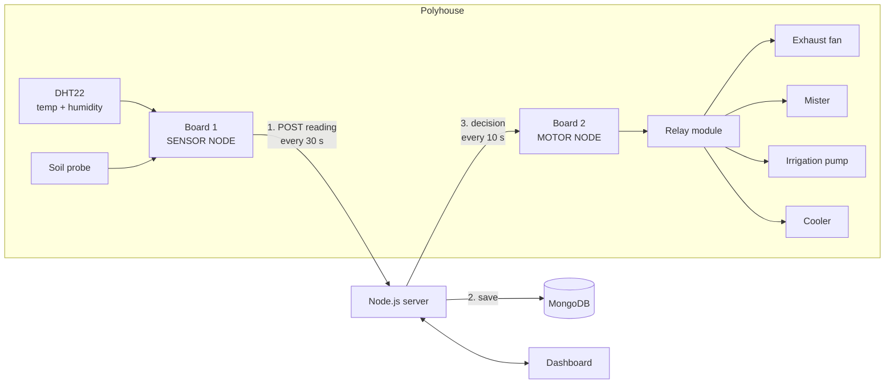
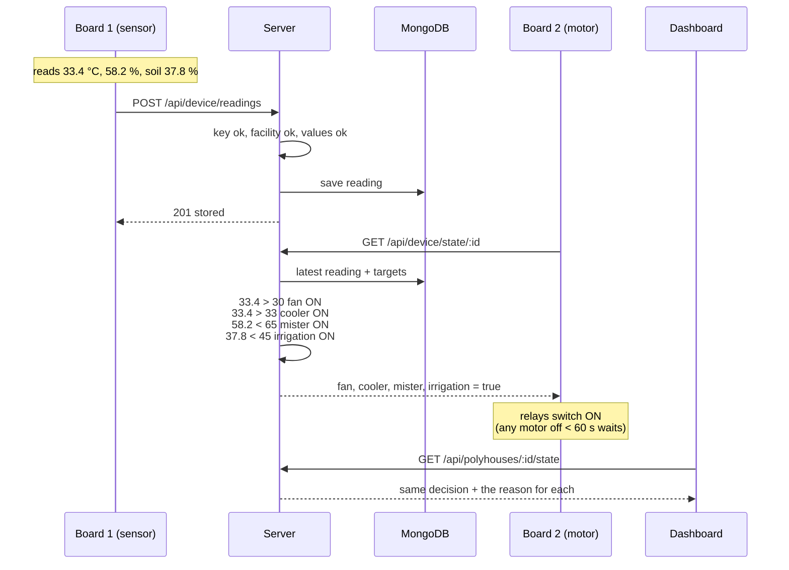

# How the two NodeMCU boards work, end to end

Each polyhouse uses **two NodeMCU (ESP8266) boards**:

| Board | Folder | Its only job |
| --- | --- | --- |
| **Board 1: Sensor node** | [`sensor_node/`](sensor_node/sensor_node.ino) | Measure the polyhouse and report it to the server |
| **Board 2: Motor node** | [`motor_node/`](motor_node/motor_node.ino) | Ask the server what the motors should do, and switch them |

**The two boards never talk to each other.** The server sits in the middle.
The sensor board *writes* readings to it, the motor board *reads* decisions
from it.

Contents

1. [The big picture](#1-the-big-picture)
2. [Wiring](#2-wiring)
3. [Board 1: Sensor node, step by step](#3-board-1-sensor-node-step-by-step)
4. [What the server does with a reading](#4-what-the-server-does-with-a-reading)
5. [How the server decides the motors](#5-how-the-server-decides-the-motors)
6. [Board 2: Motor node, step by step](#6-board-2-motor-node-step-by-step)
7. [One full cycle, with real numbers](#7-one-full-cycle-with-real-numbers)
8. [Timing: how fast does a motor react?](#8-timing-how-fast-does-a-motor-react)
9. [What happens when something fails](#9-what-happens-when-something-fails)
10. [Setting up and flashing](#10-setting-up-and-flashing)
11. [Reading the Serial monitor](#11-reading-the-serial-monitor)
12. [Settings you can tune](#12-settings-you-can-tune)
13. [What changed from the old sketches](#13-what-changed-from-the-old-sketches)

---

## 1. The big picture



The same thing as plain text:

```
                       WiFi                            WiFi
 ┌──────────────┐  POST reading   ┌─────────────┐  GET decision  ┌──────────────┐
 │  BOARD 1     │ ──────────────▶ │  Node.js    │ ◀───────────── │  BOARD 2     │
 │  SENSOR NODE │   every 30 s    │  server     │   every 10 s   │  MOTOR NODE  │
 │              │                 │             │ ─────────────▶ │              │
 │ DHT22, soil  │                 │  decides    │  fan: on ...   │ relays ──▶   │
 └──────────────┘                 └──────┬──────┘                │ fan, mister, │
                                         │                       │ pump, cooler │
                                    ┌────▼─────┐                 └──────────────┘
                                    │ MongoDB  │ ◀── Dashboard reads the same
                                    └──────────┘     data and the same decision
```

Why the decision is made on the server, not on a board:

- **One rule, one place.** The dashboard and the motor board read the same
  decision, so what you see on screen is exactly what the relays do.
- **Change targets without reflashing.** Edit the targets on the dashboard;
  the motor board picks them up on its next poll.
- **Simple boards.** The sensor board only measures, the motor board only
  switches. Each is easy to test on its own.

---

## 2. Wiring

### Board 1: Sensor node

| Part | Pin on the part | NodeMCU pin |
| --- | --- | --- |
| DHT22 | VCC | 3V3 |
| DHT22 | GND | GND |
| DHT22 | DATA | **D4** (GPIO2) |
| Soil probe | VCC | 3V3 |
| Soil probe | GND | GND |
| Soil probe | AOUT | **A0** |

### Board 2: Motor node

| Relay input | Drives | NodeMCU pin |
| --- | --- | --- |
| IN1 | Exhaust fan | **D1** (GPIO5) |
| IN2 | Fogger / mister | **D2** (GPIO4) |
| IN3 | Drip irrigation pump | **D4** (GPIO2) |
| IN4 | Evaporative cooler *(optional, new)* | **D5** (GPIO14) |
| VCC | | VIN (5 V) |
| GND | | GND |

D1, D2 and D4 are the pins your original build used, so existing wiring
works unchanged. If you have no cooler, leave IN4 unconnected; nothing breaks.

> **Power the motors separately.** The relay only switches the motor's own
> supply. Never power a pump or fan from the NodeMCU. For mains (230 V)
> motors, use a properly rated contactor and have the wiring checked.

> **If the motor board will not start with the relays plugged in,** the
> relay on D4 is the likely cause: GPIO2 must be HIGH while the ESP8266
> boots. Move irrigation to D6 and change `D4` to `D6` in `relays[]` in
> `motor_node.ino`.

---

## 3. Board 1: Sensor node, step by step

File: [`sensor_node/sensor_node.ino`](sensor_node/sensor_node.ino)

### At power-on (`setup()`)

1. Start the Serial monitor at 115200 baud and print `=== Polyhouse SENSOR node ===`.
2. Start the DHT22.
3. Join WiFi. It waits at most **20 seconds**, so a missing router cannot
   freeze the board; it simply retries on the next cycle.
4. Do the first report straight away (step 1 below), so you do not wait 30 s
   to see whether it works.

### Every 30 seconds (`loop()` → `report()`)

**Step 1: make sure WiFi is up.** If not, try to reconnect. If that fails,
skip this cycle.

**Step 2: read the DHT22.** Temperature (°C) and humidity (%). A DHT22
sometimes misses a read, so on failure it waits 2.1 s (the sensor needs 2 s
between reads) and tries once more.

**Step 3: read the soil probe.** It takes 8 readings of A0 and averages them,
because the ESP8266's analog input is noisy. The raw value (0–1023) is turned
into a percentage using two calibration numbers:

```
              SOIL_RAW_DRY - raw
moisture % = ──────────────────────────── × 100     (then clamped to 0..100)
              SOIL_RAW_DRY - SOIL_RAW_WET
```

With the defaults (dry 1023, wet 300), a raw reading of 750 gives
(1023 − 750) / (1023 − 300) × 100 = **37.8 %**.

**Step 4: decide whether to send.** If the DHT failed twice, it sends
**nothing** this cycle. Sending a broken value would only be rejected, and
skipping it is safe (see [section 9](#9-what-happens-when-something-fails)).

**Step 5: send the reading** as JSON:

```http
POST http://<API_BASE>/api/device/readings
Content-Type: application/json
X-Device-Key: <only if DEVICE_KEY is set>

{
  "polyhsid": "6ad8563497a4135d401895fa",
  "temp": 33.4,
  "humidity": 58.2,
  "moisture": 37.8
}
```

`polyhsid` is the facility id: which polyhouse this reading belongs to.

**Step 6: read the answer** and print it:

| Server answer | Meaning |
| --- | --- |
| `201` | Stored |
| `400` | A value was impossible (e.g. humidity 180 %); the reply says which |
| `401` | `DEVICE_KEY` does not match the server |
| `404` | The facility id does not exist |
| negative (e.g. `-1`) | The server could not be reached at all |

That is the sensor node's whole job. It never receives instructions and
never switches anything.

---

## 4. What the server does with a reading

When the POST arrives (`server/src/controllers/deviceController.js`):

1. **Device key check.** If `DEVICE_KEY` is set in `server/.env`, the
   `X-Device-Key` header must match, otherwise `401`.
2. **Facility check.** The `polyhsid` must be a real facility, otherwise
   `404`. This stops a typo in the firmware from quietly filing readings
   under a facility nobody can see.
3. **Value check** (`server/src/lib/readings.js`). Temperature, humidity and
   moisture are required and must be real numbers in a plausible range
   (temperature −20 to 70 °C, humidity and moisture 0 to 100 %). Anything
   else gets `400` with the reason.
4. **Save** the reading to MongoDB, collection `sensor_info`, stamped with
   the current time.

The reading is now the **latest reading** for that facility. The dashboard
charts it, and the next decision is based on it.

---

## 5. How the server decides the motors

File: `server/src/lib/control.js`. This is the **only** place in the whole
system where motor decisions are made.

It compares the **latest reading** with the **targets** you set on the
dashboard (Facility page → Climate → Target climate):

| Motor | Turns ON when | Why |
| --- | --- | --- |
| Exhaust fan | temperature **>** target | Push hot air out |
| Evaporative cooler | temperature **>** target **+ 3 °C** | The fan alone is not enough |
| Fogger / mister | humidity **<** target | Air too dry, add moisture |
| Drip irrigation | soil moisture **<** target | Soil too dry, water it |

Otherwise each motor is OFF.

### When the server refuses to decide

Sometimes there is no trustworthy decision. Then the server answers
`"ok": false`, sets **every motor to OFF**, and says why:

| Situation | Message the motor board prints |
| --- | --- |
| No targets set yet | `No targets set. Set them on the dashboard.` |
| Sensor board never reported | `No reading yet from the sensor node.` |
| Latest reading older than **5 minutes** | `Sensor node silent for N min. All relays held off until it reports again.` |

The 5-minute rule matters most with two boards. If the sensor board dies
while the soil reads "dry", the server would otherwise keep telling the motor
board to irrigate, forever. Five minutes is ten missed reports at the sensor
board's 30-second interval.

---

## 6. Board 2: Motor node, step by step

File: [`motor_node/motor_node.ino`](motor_node/motor_node.ino)

### At power-on (`setup()`)

1. Print `=== Polyhouse MOTOR node ===`.
2. **Switch every relay OFF before doing anything else.** A reboot must
   never leave a pump running.
3. Start the restart guard for every motor (see below), so after a power
   cut the motors wait 60 s before starting.
4. Join WiFi (at most 20 s) and do the first poll straight away.

### Every 10 seconds (`loop()` → `poll()`)

**Step 1: make sure WiFi is up.** If not, try to reconnect. A failure counts
as a failed poll.

**Step 2: ask the server for the decision:**

```http
GET http://<API_BASE>/api/device/state/6ad8563497a4135d401895fa
X-Device-Key: <only if DEVICE_KEY is set>
```

**Step 3: read the answer:**

```json
{
  "ok": true,
  "actuators": { "fan": true, "cooler": true, "mister": true, "irrigation": true },
  "targets": { "temp": 30, "humidity": 65, "moisture": 45 }
}
```

If the server could not decide, `ok` is `false`, a `message` explains why,
and every actuator is `false`.

**Step 4: switch each relay** to match, with one rule, the **restart guard**:

- **Switching OFF is always immediate.**
- **Switching ON waits** until the motor has been off for at least
  **60 seconds**.

Why: if the soil sits right at the target (44.9 %, 45.1 %, 44.8 % ...), the
decision flips every 10 seconds. Without the guard the pump would click on
and off all day, which wears out the pump and the relay. With it, the pump
can stop at any moment but cannot restart for a minute. It also gives motors
a pause after a power cut.

The Serial monitor shows when the guard is holding a motor back:

```
  Irrigation     wants ON, restart guard: 42 s left
```

**Step 5: count failures.** A poll fails if WiFi is down, the server is
unreachable, or the answer is not `200` with valid JSON. After **3 failed
polls in a row**, every relay is switched OFF. One successful poll resets
the count.

That is the motor node's whole job. It never reads a sensor and never
compares values itself.

---

## 7. One full cycle, with real numbers

Targets on the dashboard: **temperature 30 °C, humidity 65 %, soil 45 %**.



What happens next, minute by minute:

| Time | Sensor board | Motor board | Why |
| --- | --- | --- | --- |
| 0:00 | Sends 33.4 °C, 58.2 %, soil 37.8 % | | |
| 0:04 | | Poll: all four ON | Every value is outside its target |
| 0:30 | Sends 31.9 °C, 61.0 %, soil 41.5 % | | Fan and cooler are cooling, pump is watering |
| 0:34 | | Poll: cooler **OFF**, others ON | 31.9 is no longer above 33 |
| 1:00 | Sends 30.4 °C, 63.8 %, soil 45.6 % | | |
| 1:04 | | Poll: irrigation **OFF** | 45.6 is not below 45 |
| 1:30 | Sends 30.2 °C, 64.9 %, soil 44.9 % | | Soil dipped just under target |
| 1:34 | | Irrigation wants ON, **guard: 30 s left** | It only stopped 30 s ago |
| 2:00 | Sends 29.8 °C, 65.3 %, soil 45.2 % | | |
| 2:04 | | Fan **OFF**, mister **OFF**, irrigation stays OFF | Everything back in range; the guard stopped a pointless pump restart |

The dashboard shows each of these decisions, with the comparison behind it,
under Facility page → Climate → Relays.

---

## 8. Timing: how fast does a motor react?

| Step | Time |
| --- | --- |
| Something changes in the polyhouse | 0 s |
| Sensor board's next report | up to 30 s (+2 s if the DHT needed a retry) |
| Server stores and decides | under 0.1 s |
| Motor board's next poll | up to 10 s |
| Restart guard, only if that motor stopped in the last minute | up to 60 s |

So a motor normally reacts within **about 20 s on average and 40 s at
worst**. That is plenty for a polyhouse: temperature and soil moisture change
over minutes, not seconds.

---

## 9. What happens when something fails

| What fails | What you see | What the motors do |
| --- | --- | --- |
| **Sensor board loses power or WiFi** | Dashboard: "updated N min ago" | Keep the last decision for up to 5 min, then **all OFF** ("Sensor node silent"). Resume when it reports again. |
| **DHT22 unplugged or broken** | Sensor board: `[dht] read failed twice` | Same as above: no readings, so all OFF after 5 min |
| **Soil probe unplugged** | Soil reads 0 % or 100 % | Irrigation follows the wrong value. Watch for flat 0 / 100 on the chart. |
| **Motor board loses WiFi** | Motor board: `[poll] ... unreachable` | Keep their state, then **all OFF** after 3 failed polls (about 60 s, because each reconnect attempt waits up to 20 s) |
| **Server stopped or crashed** | Both boards: `server unreachable` | **All OFF** after 3 failed polls (about 30 s) |
| **MongoDB stopped** | Server answers `500` | Counts as a failed poll: **all OFF** after about 30 s |
| **Power cut, both boards** | Both reboot | Start **all OFF**, wait 60 s (restart guard), then follow the server |
| **Sensor board has the wrong facility id** | Sensor board: `rejected (404)` | No readings for the real facility: **all OFF** ("No reading yet") |
| **Boards have different facility ids** | Each looks fine on its own | Motor board watches a facility that gets no readings: **all OFF**. Both boards must use the **same** id. |
| **No targets set** | Motor board: `No targets set` | **All OFF** |

The pattern: whenever the system is not sure, **every motor goes off.** A
plant survives a few minutes without the fan; a polyhouse does not survive a
pump stuck on all night.

---

## 10. Setting up and flashing

### Once: Arduino IDE

1. **Board package:** Tools → Board → Boards Manager → install **esp8266** by
   ESP8266 Community (version 3.x).
2. **Board:** Tools → Board → **NodeMCU 1.0 (ESP-12E Module)**.
3. **Libraries:** Tools → Manage Libraries → install
   - **ArduinoJson** by Benoit Blanchon (version 7)
   - **DHT sensor library** by Adafruit (accept **Adafruit Unified Sensor** when asked)

### Get the settings

1. Start the server and open the dashboard.
2. Open the polyhouse → **Device setup** tab.
3. Click **Copy**. The block already has this computer's network address and
   the facility id.

`API_BASE` must be the computer's **LAN address**, such as
`http://192.168.1.50:5000`. **Never `localhost`**: to a board, localhost is
the board itself. The Device setup tab shows the right address; you can also
run `ipconfig` and use the IPv4 address of the WiFi adapter.

### Flash both boards

| | Board 1 | Board 2 |
| --- | --- | --- |
| Open | `sensor_node/sensor_node.ino` | `motor_node/motor_node.ino` |
| Paste the settings block over | the `SETTINGS` section | the `SETTINGS` section |
| Fill in | WiFi name and password | WiFi name and password |
| Extra | Calibrate `SOIL_RAW_DRY` / `SOIL_RAW_WET` | Check `RELAY_ACTIVE_LOW` |
| Upload | ✓ | ✓ |

**Both boards get the same `API_BASE`, `FACILITY_ID` and `DEVICE_KEY`.**

### Check it works, in this order

1. **Sensor board** Serial monitor shows `[send] stored (201)` every 30 s.
2. **Dashboard** facility page shows "updated a few seconds ago".
3. **Set targets** on the dashboard (Climate → Target climate).
4. **Motor board** Serial monitor shows `[poll] decision received` and the
   relays it switches.
5. **Dashboard** Relays panel matches what the relays are doing.

### Calibrating the soil probe

1. Open the sensor board's Serial monitor. Each line shows `raw` next to the soil %.
2. Hold the probe in dry air, note the raw value → `SOIL_RAW_DRY`.
3. Put it in a glass of water (up to the line), note the raw value → `SOIL_RAW_WET`.
4. Put both in the sketch and upload again.

### Checking relay direction

Most relay modules switch ON when the pin goes LOW ("active-low"); your
original board was wired the other way. With **no targets set**, every motor
should be **off**. If they are all on instead, set `RELAY_ACTIVE_LOW = true`
in `motor_node.ino` and upload again.

---

## 11. Reading the Serial monitor

Tools → Serial Monitor, **115200 baud**.

### Board 1: Sensor node

```
=== Polyhouse SENSOR node ===
[wifi] connecting to MyWiFi.....
[wifi] connected, board IP 192.168.1.71
[read] temp 33.4 C | humidity 58.2 % | soil 37.8 % (raw 750)
[send] stored (201)
```

| Line | Meaning | Fix |
| --- | --- | --- |
| `[send] stored (201)` | Working | |
| `[send] server unreachable (-1)` | Cannot reach the server | Wrong `API_BASE`, `localhost`, different WiFi, or Windows Firewall blocking port 5000 |
| `[send] rejected (404): No facility with id ...` | Wrong facility id | Copy it again from Device setup |
| `[send] rejected (400): humidity=180 is outside 0..100` | Sensor sent an impossible value | Check that sensor |
| `[send] rejected (401)` | Device key mismatch | Match `DEVICE_KEY` to `server/.env` |
| `[dht] read failed twice` | No answer from the DHT22 | Check wiring on D4; check `DHT_TYPE` (DHT22 vs DHT11) |

### Board 2: Motor node

```
=== Polyhouse MOTOR node ===
[wifi] connected, board IP 192.168.1.72
[poll] decision received
  Exhaust fan -> ON
  Mister      -> ON
  Irrigation     wants ON, restart guard: 48 s left
```

| Line | Meaning |
| --- | --- |
| `[poll] decision received` | Working |
| `-> ON` / `-> OFF` | A relay just switched |
| `wants ON, restart guard: N s left` | Normal; waiting out the 60 s guard |
| `[poll] no decision: Sensor node silent for 6 min ...` | Board 1 stopped reporting; all motors held off on purpose |
| `[poll] no decision: No targets set ...` | Set targets on the dashboard |
| `[poll] server unreachable (-1)` | Same causes as on the sensor board |
| `[safety] server unreachable for 3 polls - all relays OFF` | Failsafe tripped |

---

## 12. Settings you can tune

| Setting | Where | Default | Effect |
| --- | --- | --- | --- |
| `REPORT_INTERVAL_MS` | `sensor_node.ino` | 30 000 (30 s) | How often readings are sent |
| `SOIL_RAW_DRY`, `SOIL_RAW_WET` | `sensor_node.ino` | 1023, 300 | Soil probe calibration |
| `DHT_TYPE` | `sensor_node.ino` | DHT22 | Set DHT11 for that sensor |
| `POLL_INTERVAL_MS` | `motor_node.ino` | 10 000 (10 s) | How often the decision is fetched |
| `MIN_OFF_MS` | `motor_node.ino` | 60 000 (60 s) | Restart guard |
| `FAILSAFE_AFTER` | `motor_node.ino` | 3 | Failed polls before all OFF |
| `RELAY_ACTIVE_LOW` | `motor_node.ino` | false | Relay direction |
| `STALE_AFTER_MS` | `server/src/lib/control.js` | 5 min | How old a reading may be before motors go off |
| `COOLER_MARGIN_C` | `server/src/lib/control.js` | 3 °C | How far above target before the cooler joins the fan |
| Targets | Dashboard | per polyhouse | The values everything is compared with |
| `DEVICE_KEY` | `server/.env` + both sketches | empty | Shared secret so only your boards can send |

If you make the sensor board report less often, raise `STALE_AFTER_MS` to
match, or the motors will switch off between reports.

---

## 13. What changed from the old sketches

This folder used to have three sketches: `checksensoilmoisture4` (sensor
board), `datarecjs4` (motor board) and `sensornode` (a single-board version
that is not needed when you use two boards). Now there are two, named after
their jobs.

| Old | Problem | Now |
| --- | --- | --- |
| `checksensoilmoisture4` | Sent 3 values to a URL the server only matched with 8, so **every reading got a 404 and was lost**. It ignored the response, so nothing showed it. A failed DHT read was sent as the text `nan`. | `sensor_node`: JSON endpoint, clear Serial messages, skips failed reads, soil calibration |
| `datarecjs4` | **Did not compile** on current libraries (ArduinoJson 5 API, removed `http.begin(url)`). Compared the values itself, so it could disagree with the dashboard. Printed "valve2 On" when it switched the valve off. Only 3 relays. | `motor_node`: follows the server's decision, failsafe, restart guard, 4 relays, correct messages |
| `sensornode` | A one-board design, not your setup | Removed |
| Server | Kept deciding from the last reading forever if the sensor board went silent | Motors go off when the latest reading is over 5 minutes old |
